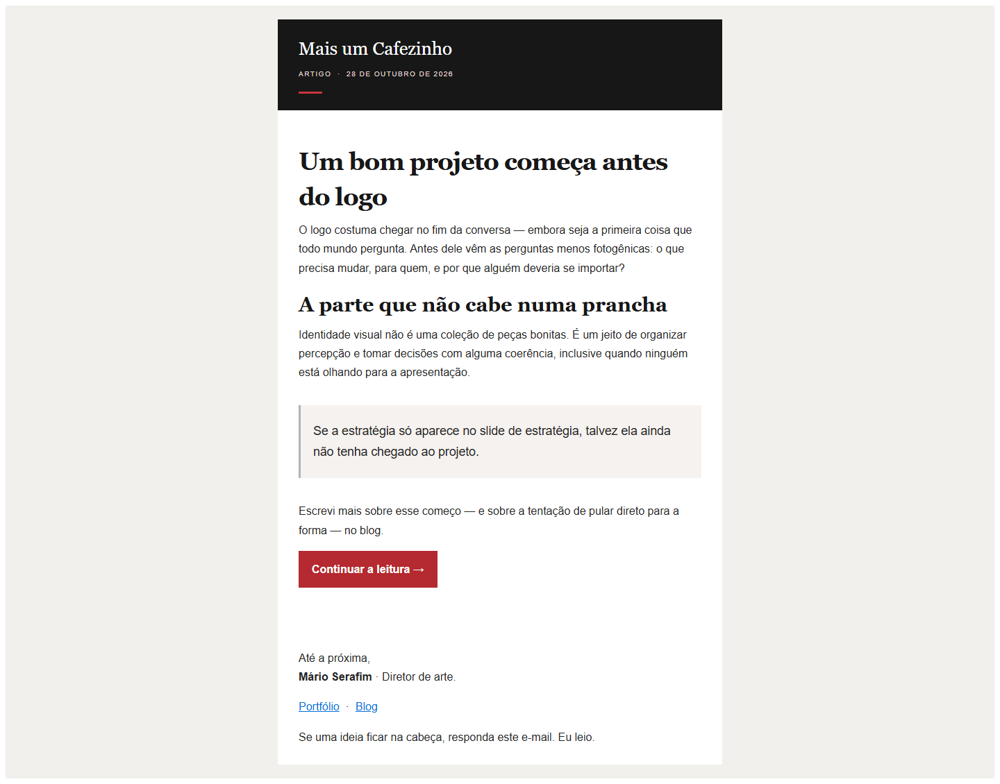
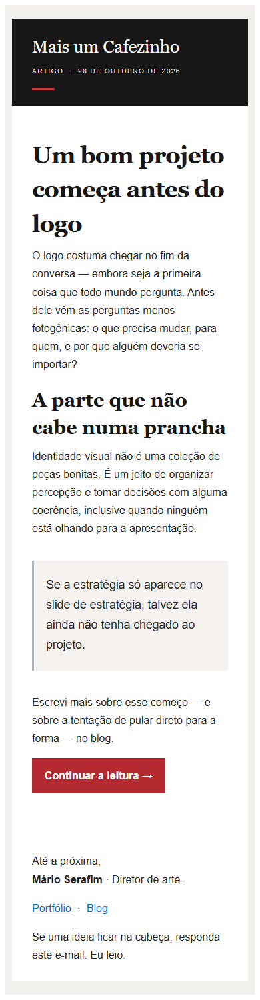
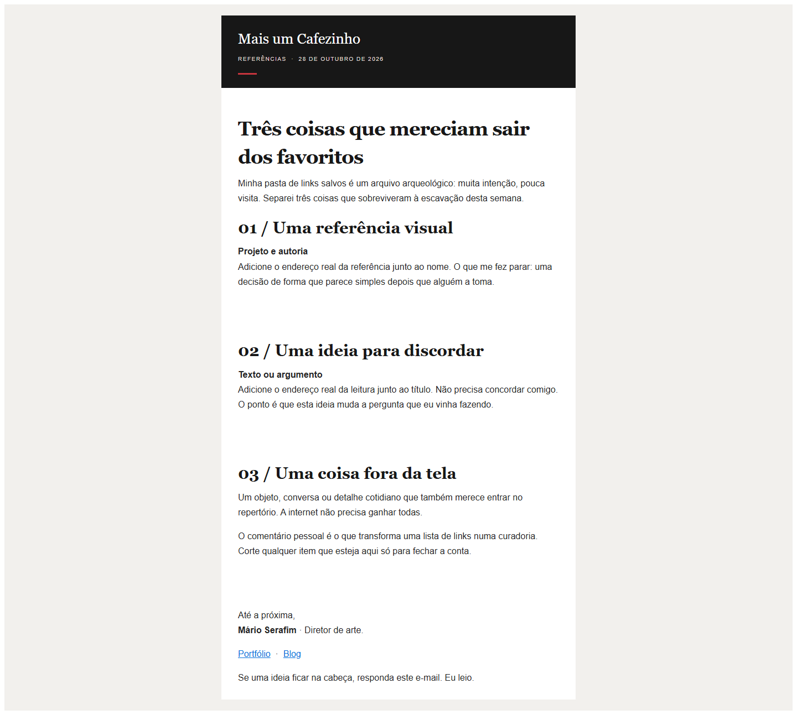
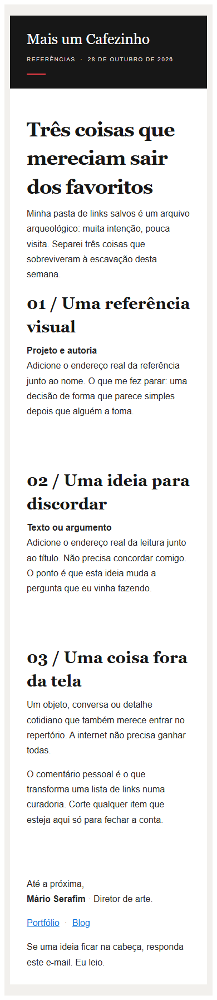
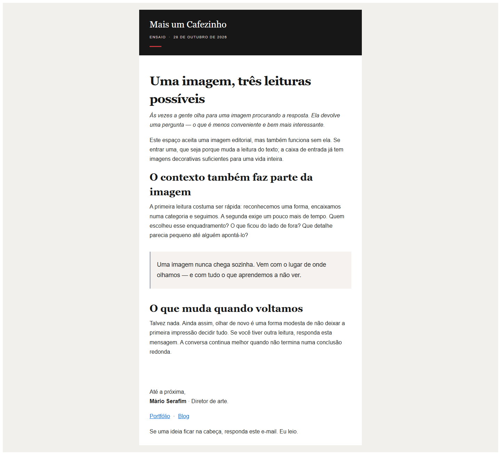
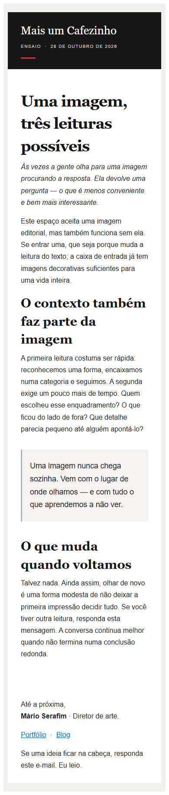

# Redesign editorial e entregabilidade

Branch: `codex/editorial-email-redesign`

Base: `origin/main` em `815da2d`

## Comparativo visual

| Captura recebida | Nova composição |
| --- | --- |
| O PDF mostra o template Modern da Buttondown repetindo a marca/assunto, um preâmbulo em inglês, o rodapé do provedor junto de um descadastro no corpo e uma imagem principal cortada. | O corpo do CRM passa a usar uma moldura de tabela de até 640 px, cabeçalho preto, acento vermelho, títulos serifados, texto sans-serif, espaçamentos definidos e um CTA em vermelho. O Classic fica selecionado por rascunho e evita repetir o cabeçalho externo. |
| A captura confirma a chegada da mensagem, mas não contém os cabeçalhos originais nem prova a aba Principal/Promoções. | As telas abaixo são simulações locais no Chromium. Não são capturas do Gmail, Outlook ou do HTML já processado pela conta Buttondown. |

### Novidades do blog

Desktop, 1.440 px:

Celular, 390 px:

### Curadoria editorial

Desktop, 1.440 px:

Celular, 390 px:

### Edição especial

Desktop, 1.440 px:

Celular, 390 px:

As variantes `*-dark-simulation.png` registram a mesma página sob a preferência escura do Chromium. Os três modelos começam sem imagem; portanto, não há diferença entre imagens carregadas e bloqueadas nesses exemplos. Imagens inseridas no editor recebem largura fluida e mantêm o texto alternativo. O resultado em clientes reais depende do processamento e das regras de cada caixa postal.

## O que mudou

- Os três templates agora compartilham uma moldura de e-mail feita com tabelas de apresentação e estilos inline, mas têm textos e ritmo próprios.
- O assunto deixou de ser repetido literalmente no título do corpo. Os títulos são editoriais e distintos do assunto.
- O template de curadoria não traz endereços fictícios. O autor adiciona o destino real de cada referência antes de sincronizar.
- A edição especial não depende de imagem e continua legível sem mídia. O editor aplica largura máxima às imagens adicionadas e alerta quando falta texto alternativo.
- A assinatura usa “Mário Serafim · Diretor de arte”, inclui portfólio e blog e acrescenta Instagram, LinkedIn e e-mail quando configurados.
- O corpo não injeta outro link de descadastro. Classic e Modern mantêm o rodapé de descadastro gerido pela Buttondown; a prévia local informa que esse rodapé não está nela.
- O campo “Texto de prévia (preheader)” usa `description` por e-mail na Buttondown. A data da edição e o template externo escolhido também ficam no documento JSON do rascunho.
- O documento estruturado continua sendo a fonte de edição no D1. Os metadados novos foram adicionados ao JSON já existente, sem migração.
- As rotas de sincronização aceitam somente `status: draft` e permitem escolher Classic ou Modern por rascunho. Não alteram o template global, não publicam e não expõem Naked.

## Classic e Modern na Buttondown

A documentação descreve o Classic como minimalista e centrado no conteúdo. O Modern acrescenta masthead, assunto, data e preâmbulo (“Did someone forward you this?”). Isso corresponde aos elementos externos em inglês que aparecem no PDF. O CRM seleciona Classic nos novos rascunhos; Modern permanece disponível como escolha individual. Se Modern for escolhido, o CRM omite seu próprio cabeçalho para reduzir repetição.

O template configurado por e-mail é suportado pela API. O rodapé/descadastro continua sob controle da Buttondown. Não foi alterada nenhuma configuração global, não foi ativado Naked e não foi contratado um plano. A Buttondown informa que o envio por domínio próprio existe também no Free, enquanto a remoção da marca Buttondown depende do Professional.

Referências: [design de e-mail e templates Classic/Modern](https://docs.buttondown.com/designing-your-email), [criação pela API](https://docs.buttondown.com/api-emails-create), [atualização pela API](https://docs.buttondown.com/api-emails-update), [preheader e `description`](https://docs.buttondown.com/glossary-developers), [white-label e limites de plano](https://docs.buttondown.com/whitelabeling).

## Autenticação e entregabilidade

- No PDF, o remetente visível é `marioserafim@buttondown.email`. A mensagem chegou, mas isso não permite concluir SPF, DKIM, DMARC, alinhamento nem a classificação final do Gmail. A captura não inclui cabeçalhos originais `Authentication-Results`, `List-Unsubscribe` ou `List-Unsubscribe-Post`.
- Consulta pública de DNS feita em 28/10/2026: o domínio raiz `marioserafim.com.br` anuncia MX do Zoho, SPF `v=spf1 include:zohomail.com -all` e DMARC `v=DMARC1; p=reject;`. Não foi possível verificar os cabeçalhos do envio Buttondown nem confirmar a chave/seletor DKIM do Zoho. O SPF/DMARC do domínio raiz não prova autenticação do remetente atual `@buttondown.email`.
- Não foi feita uma inspeção autenticada das configurações da conta Buttondown. Portanto, o estado de rastreamento de aberturas/cliques permanece desconhecido. A documentação diz que open tracking, quando habilitado, injeta um pixel; isso não prova que o recurso esteja habilitado nem permite atribuir a classificação do Gmail a ele.
- Para um remetente próprio, a alternativa compatível com Free é configurar um subdomínio dedicado para envio — por exemplo `news.marioserafim.com.br` — seguindo os registros exatos apresentados em Settings da Buttondown. Não substitua o SPF/DMARC/MX existentes do domínio raiz: eles atendem ao Zoho e aos demais serviços. Nenhuma alteração DNS foi feita.
- Para aumentar a chance de classificação adequada, use autenticação alinhada no domínio de envio, mantenha assuntos informativos, um CTA editorial, proporção texto/imagem equilibrada, uma lista consentida e convite genuíno para respostas. A política do Gmail exige SPF ou DKIM para todos os remetentes e requisitos adicionais para remetentes em massa; autenticação não garante a aba Principal.
- O Gmail decide a classificação. Recomendações e validações de HTML não podem garantir a aba Principal. A verificação objetiva do envio real exige os cabeçalhos originais da mensagem; não foram acessados nesta tarefa.

Referências: [diretrizes do Gmail](https://support.google.com/mail/answer/81126?hl=en), [domínio de envio da Buttondown](https://docs.buttondown.com/sending-from-a-custom-domain), [open tracking](https://docs.buttondown.com/open-tracking).

## Validação

- `pnpm lint`
- `pnpm build`
- `pnpm test`
- `pnpm test:e2e`
- Script de prévias: `pnpm dev --host 127.0.0.1` e `pnpm exec node scripts/capture-editorial-email-previews.mjs`.

As prévias locais passaram por 1.440 px desktop e 390 px celular, com zero rolagem horizontal e zero imagens nos três modelos iniciais. A variante escura também foi renderizada no Chromium. Não havia Gmail ou Outlook conectado para um teste real; a Buttondown não foi sincronizada com uma campanha de redesign e nenhuma mensagem foi enviada.
